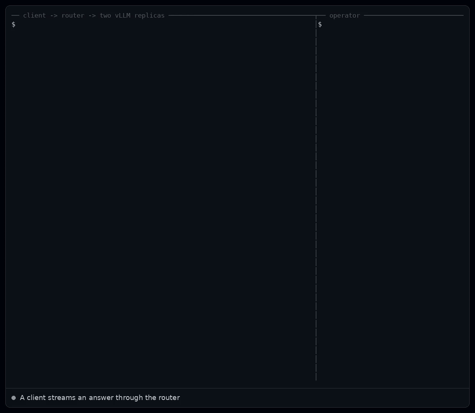
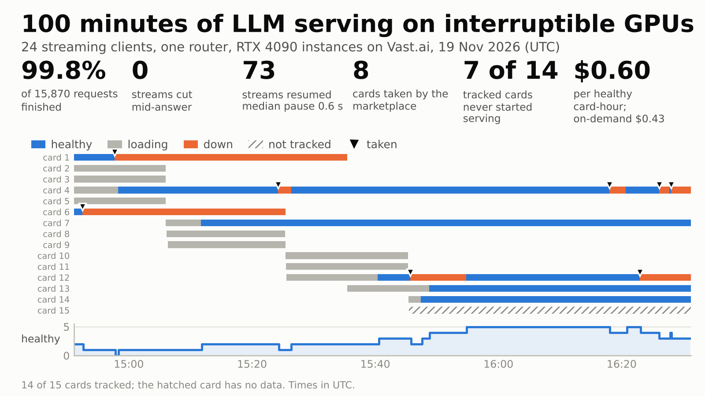

# undead

An LLM answer that survives the death of the replica generating it. With batch invariance on, the rest of the answer is the same tokens the dead replica would have produced.

`undead` is a small router that sits in front of vLLM replicas. It keeps the token IDs of every answer. If a replica dies or goes silent in the middle of a stream, the router sends the prompt IDs plus the IDs already emitted to another replica with the same seed. The client sees a pause, then the next token.

This is recovery by replay, not migration of GPU state: the second replica reads the prompt and the emitted tokens again. Replay itself is not new, see "What already exists" below. What this repository adds is a measurement: when the replayed answer goes on with the same tokens, and what breaks that.

## Demo



Left: a client streams an answer through the router. Right: `kill -9` hits the replica that is serving it. The answer goes on, then the same request runs again with nothing killed, and the two answers have the same token IDs.

Recorded on one RTX 4090 with two Qwen2.5-1.5B replicas, batch invariance on. The pause in this take was 174 ms. On that machine the OS needed about 140 ms to close the killed process's connection, and the resumed request returned its first token in about 25 to 45 ms. `demo/run_demo.sh` records the session and `demo/render_cast.py` turns it into video.

The text in the video is what the terminal showed. The renderer adds the rest: the kill plays at quarter speed and the control run at double speed, a red mark shows where the stream stopped, the text that came after the resume is tinted blue, and a caption line runs under the terminal. `python demo/render_cast.py demo/demo.cast plain.mp4 --plain` renders the recording as it was, in real time.

## Results so far

Pilot run on 16 November 2026: vLLM 0.33.0, two RTX 4090 on two machines, Qwen2.5-1.5B, Qwen2.5-7B and Qwen3-1.7B in bf16.

- With `VLLM_BATCH_INVARIANT=1` the resumed answer matched an uninterrupted control token for token in 2124 cuts out of 2124, logprobs bit-identical. 300 of those started on one machine and finished on the other.
- `kill -9` on a replica in the middle of an answer: 94 answers out of 94 came out identical to the control. The median pause was 32 to 74 ms. A frozen replica costs about one second, which is the router's silence timeout.
- Without batch invariance 55 to 65% of resumed answers differ from the control. They still finish without errors.
- Batch invariance costs throughput. At 16 concurrent streams: 3.3x on Qwen2.5-1.5B, 2.7x on Qwen3-1.7B, 2.1x on Qwen2.5-7B.
- A check on 17 November, on a fourth machine with another driver version, gave the same tokens for the same requests: 24 control answers out of 24, logprobs bit-identical.

The tables are in [pilot-2026-11-16/RESULTS.md](pilot-2026-11-16/RESULTS.md). The raw journals and a script that recomputes every number are next to it.

## On interruptible GPUs

On 19 November 2026 I ran the router for 100 minutes on interruptible RTX 4090s rented at Vast.ai, where the marketplace can stop an instance at any moment. It stopped a serving card 8 times. Of 15,870 streaming requests 15,831 finished and 39 got HTTP 503 while capacity was short. No stream was cut mid-answer: 73 answers moved to another card and finished there.

It was not cheaper than on-demand: $0.60 per card-hour that served against about $0.43, because only 4.84 of the 10.59 rented card-hours were spent serving.



The run used the router from the `router-registry` branch, which adds a replica registry, a stream limit per replica, a queue and a request journal. The replicas ran without batch invariance, so the run shows that streams survive, not that the resumed tokens are identical. Scripts, logs and the report are in [spot/](spot/).

## How it works

1. The client sends a normal `POST /v1/chat/completions`.
2. The router tokenizes the prompt and calls a replica's `/v1/completions` with token IDs and `return_token_ids`. Every new token ID goes into the answer log.
3. A replica counts as failed when the connection drops, when vLLM reports `abort` or `error`, or when no token arrives for longer than a silence timer.
4. The router then sends `prompt_ids + output_ids` to another replica with the same seed and the remaining `max_tokens`.

The tail comes out identical because of two things in vLLM 0.33.0. The sampler in model runner V2 derives its noise from the seed, the position and the token ID, so a request that carries the emitted tokens in its prompt draws the same noise. Batch invariance makes the logits independent of what else is in the batch.

## Two modes

The mode is not a router setting. It is how the replicas are started.

| | Fast | Strict |
|---|---|---|
| Replicas | batch invariance off, the vLLM default | `VLLM_BATCH_INVARIANT=1` |
| Speed | full | 2.1x to 3.3x lower at 16 streams in my runs |
| After a failure | the answer finishes, the tail is a different sample | the answer finishes with the same tokens |
| Measured | 185 runs through the router with no errors, 55 to 65% of resumed tails differ from the control | 2124 cuts out of 2124 match the control |

Fast is the default, and nobody pays for batch invariance unless they need the same tokens.

Strict needs:

- `VLLM_BATCH_INVARIANT=1` and `VLLM_USE_V2_MODEL_RUNNER=1` on every replica.
- The same GPU model and vLLM version on every replica. Three driver versions gave the same tokens in my runs. Mixed GPU models are not tested.

Both modes need a second replica that is already up. A cold start on a fresh machine took about three minutes.

## What already exists

Resuming a broken stream is not new. These are the ones I know of as of November 2026.

| Project | What happens when a stream breaks | Same tokens as an uninterrupted run |
|---|---|---|
| [NVIDIA Dynamo, request migration](https://docs.nvidia.com/dynamo/v1.3.0/user-guides/fault-tolerance/request-migration) | The prompt and the tokens already generated go to another worker. Off by default. Structured output and `n > 1` are not migrated. | The docs do not say. |
| [LiteLLM, mid-stream fallback](https://docs.litellm.ai/docs/proxy/reliability) | The text generated so far goes to a fallback model, which carries on from it. | No. It works on text, not on token IDs. |
| [AISIX, mid-stream fallback](https://docs.api7.ai/ai-gateway/routing/mid-stream-fallback) | The client stream stays open and a fallback model is asked to continue the partial answer. | No. The docs say it is not token-exact. |
| [Llumnix](https://arxiv.org/abs/2406.03243), OSDI '24 | A running request moves with its KV cache between healthy instances. Requests on a failed instance are aborted. | The state is moved, not replayed. |
| [SpotServe](https://arxiv.org/abs/2311.15566), ASPLOS '24 | The KV cache is moved during the notice period before a spot preemption, and decoding resumes at the token level. | The state is moved, not replayed. |

Routers such as llm-d and vLLM production-stack pick a replica for a new request. I did not find anything in their docs about a stream that already started. If I missed it, tell me.

So the replay here is the same idea as Dynamo's request migration. What is different: the check that the replayed tail is the same tokens the dead replica would have produced, the numbers on when that holds and what breaks it, and a small router that does it for plain vLLM.

## Try it without a GPU

```bash
pip install aiohttp
python tests/run_tests.py --n 100
```

The script starts fake replicas and routers on local ports 19001-19004 and 18080-18083. It covers `kill -9`, `SIGSTOP`, a client that disconnects and comes back, a request that kills every replica it touches, all replicas dead, one replica or all of them frozen before the request, a replica that keeps the connection open but stops sending tokens, HTTP 400 from a replica, `abort` and `repetition` finish reasons, an answer cut in the middle of a character, replicas that require an API key, resume cursors, request fields the router does not forward, and requests with a foreign `Origin` or `Host` header.

## Run it on real vLLM

The measurements were made on vLLM 0.33.0. On 0.34.0 `check_vllm.py` passes and the demo request gives the same tokens, and that is all I checked there.

The vLLM 0.33.0 wheel on PyPI is built for CUDA 13. On a machine whose driver stops at CUDA 12.7 (565.77) it failed at import with a missing `libcudart.so.13`.

```bash
VLLM_BATCH_INVARIANT=1 VLLM_USE_V2_MODEL_RUNNER=1 vllm serve Qwen/Qwen2.5-1.5B-Instruct \
    --port 8001 --generation-config vllm --gpu-memory-utilization 0.42 \
    --no-enable-prefix-caching --attention-backend FLASH_ATTN
# second replica: the same with --port 8002

python check_vllm.py --url http://127.0.0.1:8001 --url2 http://127.0.0.1:8002

python router.py --replicas http://127.0.0.1:8001,http://127.0.0.1:8002 \
    --model Qwen/Qwen2.5-1.5B-Instruct --port 8080

curl -N http://127.0.0.1:8080/v1/chat/completions -H 'Content-Type: application/json' \
    -d '{"messages":[{"role":"user","content":"Write a long story about a server node"}],
         "stream":true,"max_tokens":800,"temperature":0.7,"seed":42}'
# in another terminal: kill -9 -<process group id of one replica>
```

## Router API

- `POST /v1/chat/completions`: OpenAI-style. The response carries an `X-Answer-Id` header, and every SSE event has `id: <answer_id>:<position>`.
- `GET /v1/streams/{answer_id}?from=N`: read the rest of an answer after a disconnect. N is the position from the id of the last event the client received, and any other value gets HTTP 400. A `Last-Event-ID` header works too. The log is kept for 60 seconds after the answer ends.
- `GET /v1/answers/{answer_id}`: debug view with the hash of the token IDs, replicas used, attempts and pauses.
- `GET /metrics`: counters and active answers.

If the replicas run with a key (`--api-key` or `VLLM_API_KEY`), pass it to the router with `--replica-api-key` or the `UNDEAD_REPLICA_API_KEY` variable.

## Reproducing the measurements

```bash
python step0.py run 0a        # one card, two replicas, batch invariance on
python step0.py run 0c        # same card, vLLM defaults
python step0.py run 0b --replica-urls http://A:port,http://B:port    # two machines
python probe_params.py --url http://127.0.0.1:8001 --url2 http://127.0.0.1:8002 --model MODEL
```

`step0.py` starts two `vllm serve` replicas on one card, the router and the background load. It writes every request and every comparison to `results/<stage>-<time>/events.jsonl`. The harness and the test tools print in Russian for now.

A dry run without a GPU:

```bash
python step0.py run 0a --dry --n 8 --max-tokens 400
python step0.py run 0a --dry --dry-drift token --n 6    # the harness must report mismatches here
```

## Limits of this version

- The router forwards only `temperature`, `top_p`, `seed` and `max_tokens`, and assigns a seed when the client sends none. Other fields that change the answer get HTTP 400 when they are set: `stop`, `tools`, `response_format`, structured outputs, the penalties, `top_k`, `min_p`, `logit_bias`, `min_tokens`, `n`, `logprobs`, `chat_template_kwargs`. Fields the router does not know are ignored, `stream_options` included.
- `presence_penalty`, `frequency_penalty` and structured outputs cannot be resumed this way. The measurements are in the results file.
- If `max_tokens` cuts the answer in the middle of a character, that character is left out of the text. Its token IDs stay in the log.
- The timeouts assume replicas that are not overloaded. A replica that stays silent longer than the silence timer loses the answer to another replica, and what it computed after that is thrown away.
- One router process, and the answer log lives in memory.
- No replica health checks and no client auth. Do not expose the router to the internet.
- If a client leaves and never comes back, the answer is still generated to the end.

## Security

This is a research prototype and I have not hardened it.

- The router has no client authentication, so it listens on 127.0.0.1 by default. Anyone who can reach the port can start answers and read the ones in progress: `/metrics` lists the IDs of active answers, and `/v1/answers/{id}` and `/v1/streams/{id}` return their text.
- If you start it with `--host 0.0.0.0`, put a proxy that checks who is calling in front of it.
- A web page open in a browser on the same machine can reach localhost too, so the router refuses requests that came from one. A request with an `Origin` header gets HTTP 403 unless the origin is the router's own address or a localhost page. A router that listens on localhost also answers 403 to a `Host` header that is not a localhost name, and that stops DNS rebinding. `--allowed-origins` and `--allowed-hosts` add entries, and `*` turns a check off.
- Prompts and answers are kept in memory and dropped 60 seconds after the answer ends. The router writes nothing to disk.
- `step0.py serve` starts a vLLM replica that listens on all interfaces. Give it `--api-key`, or `--host 127.0.0.1` when the replicas are reached through a tunnel.
- Pass the replica key in `UNDEAD_REPLICA_API_KEY` rather than `--replica-api-key`. Command-line arguments show up in the process list.

If you find a security problem, open an issue.

## Where this is going

The router is the first piece of a larger system: a Kubernetes setup that moves inference between cheap interruptible GPUs of different providers and does not drop answers on the way. The planner and the operator are not written yet.

Next for the router itself: two pools of replicas, fast and strict, with the choice made per request, and a way to regenerate an answer on the strict pool from the same seed.

## Files

| File | What it is |
|---|---|
| `router.py` | The router: OpenAI-style API, token log, resume on another replica, client reconnect |
| `step0.py` | Measurement harness: compares a resumed answer with an uninterrupted one |
| `probe_params.py` | Checks which request parameters survive a resume |
| `check_vllm.py` | Two-minute check of a live vLLM replica |
| `prompts.py` | 50 test prompts and 16 background-load prompts |
| `toks.py` | Tokenizers: the real one (`hf`) and a byte-level one for tests (`bytes`) |
| `fake_replica.py` | Fake replica with a vLLM-like API, for tests without a GPU |
| `tests/run_tests.py` | Router tests on fake replicas |
| `demo/` | The recorded demo: client, kill helper, terminal recorder, renderer, and the video |
| `pilot-2026-11-16/` | Results of the pilot run, raw journals, `verify.py` |
| `spot/` | Runs on interruptible GPUs: price collector, renter, load generator, logs and report of the 19 November run |

## License

Apache-2.0, see [LICENSE](LICENSE).
