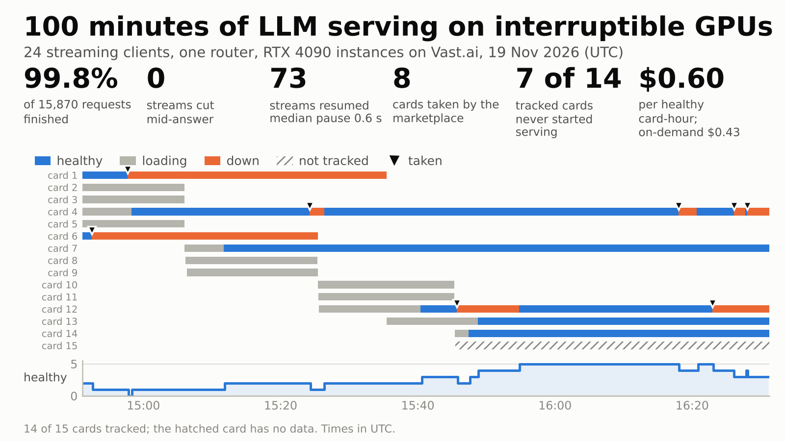

# Runs on interruptible GPUs

Scripts and logs from running undead on interruptible instances rented at Vast.ai. The scripts were written for these runs and are published as they ran.

## 19 November 2026: 100 minutes on RTX 4090s

24 streaming clients, 500 tokens per answer, Qwen2.5-7B-Instruct on vLLM 0.33.0, a target of six live cards. The marketplace can stop an interruptible instance at any moment.



| What | Value |
|---|---|
| Requests | 15,870 |
| Finished | 15,831 (99.75%) |
| Rejected with HTTP 503 after 10 seconds in the queue | 39 |
| Streams cut mid-answer | 0 |
| Streams moved to another card mid-answer | 73, median pause 0.63 s |
| Cards rented | 15: 7 served, 7 never did, 1 was lost to a bug in my tooling |
| Marketplace stopped a serving card | 8 times in 4.84 serving card-hours |
| Cost | $2.92, which is $0.28 per rented card-hour and $0.60 per card-hour that served |
| Cheapest on-demand listings of the same GPU at the time | about $0.43 per hour |

No stream was cut, and it still cost more per serving card-hour than on-demand, because only 4.84 of the 10.59 rented card-hours were spent serving. The setup, the limits of this run and the raw logs are in [runs/2026-11-19-fleet](runs/2026-11-19-fleet/).

The replicas ran without batch invariance, so this run shows that streams survive. It does not show that the resumed tokens are the ones the lost card would have produced. The [pilot](../pilot-2026-11-16/RESULTS.md) measured that.

## Files

| Path | What it is |
|---|---|
| `collector/collect.py` | One run asks the public Vast offer search for on-demand and interruptible offers of nine GPU models and appends them to a daily file. Needs no API key. I run it every 10 minutes |
| `collector/stats.py` | Quick health and price check over the collected files |
| `canary/canary.py` | Rents interruptible instances, polls them and destroys them. It spends real money, see below |
| `canary/fleet.py` | Keeps the router's replica list equal to the instances that pass a health check |
| `canary/load.py` | Load generator: N streaming clients, one log line per request |
| `canary/run2h.sh` | Starts the router, `fleet.py` and `load.py` for a run. The paths in it are the ones on my server |
| `canary/demo_preempt.sh` | An earlier two-card test: drops the bid of one card while answers are streaming |
| `canary/vllm-fast.json` | The instance profile of the run: image, vLLM arguments, port, health check |
| `report_run.py` | Turns the logs of a run into `summary.txt`, charts and a time-lapse |
| `make_fake.py` | Writes a synthetic set of logs, for trying `report_run.py` without a run |
| `runs/2026-11-19-fleet/` | Logs and report of the run above |

The `test_*.py` files next to the scripts run with `python3 -m pytest`. `load.py` needs aiohttp and `report_run.py` needs numpy, matplotlib and Pillow. The other scripts use only the standard library.

## Before you run canary.py

It rents GPUs with your Vast API key, so it costs money. `rent`, `bid`, `drop` and `stop` do nothing without `--yes`, and they touch only the instances the tool created, whose ids are in its `state.json`. `canary.py poll` is the exception: it destroys the instances of a run without asking when the time cap, the budget cap or a low account balance is reached, so it has to run on a timer. The two systemd unit files next to it run it every minute. `canary.py plan` rents nothing: it prints the offers a run would take and what they would cost.

`fleet.py` and `run2h.sh` need the router from the [router-registry](https://github.com/Pessimist228/undead/tree/router-registry) branch. That branch adds a replica registry with an admin API, a stream limit per replica, a queue and a request journal. It is not merged into main yet.

## Recompute the numbers

```bash
pip install numpy matplotlib pillow
python3 spot/report_run.py --dir spot/runs/2026-11-19-fleet --out /tmp/report --ondemand-price 0.43 --no-video
```

This writes `summary.txt`, `summary.json` and the charts. Without `--no-video` it also renders the time-lapse, which needs ffmpeg.
