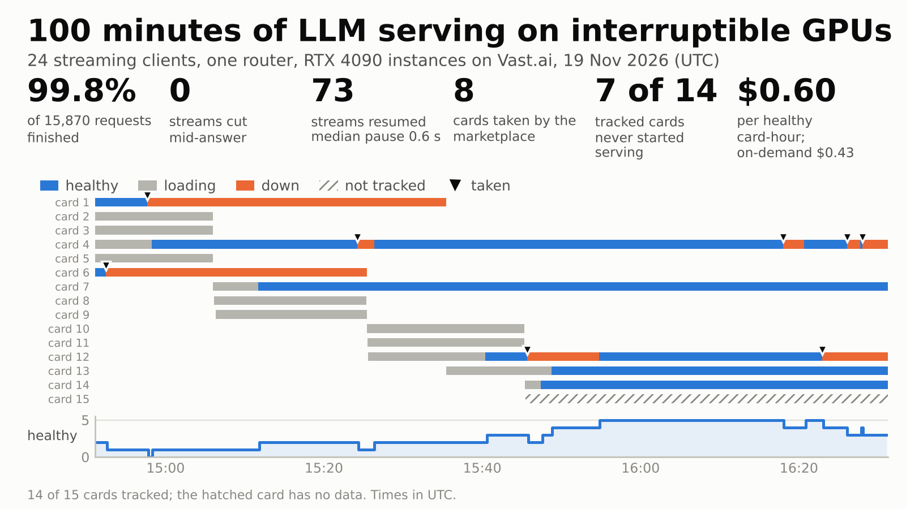

# 100 minutes on interruptible RTX 4090s

19 November 2026, load from 14:51 to 16:31 UTC. Every number below is in [report/summary.txt](report/summary.txt), and `report_run.py` recomputes it from the logs in this folder.

[report/timelapse.mp4](report/timelapse.mp4) plays the run in 34 seconds.

## Setup

Vast.ai, verified hosts, RTX 4090, bids 15% (first three cards) or 30% (the rest) above each offer's minimum. vLLM 0.33.0, Qwen2.5-7B-Instruct, no batch invariance, and the router from the `router-registry` branch. 24 concurrent streaming clients, 500 tokens per answer, 16 streams per card at most, HTTP 503 after a 10 second wait for a slot. Target of six live cards. Four times during the run, at 15:05, 15:25, 15:35 and 15:45 UTC, I replaced cards by hand: those that hadn't started serving 19 to 20 minutes after rent, and two that had been down for more than 30 minutes.

## Cards

15 rented, 7 served, 7 never did, 1 was lost to a bug in my own tooling: only its creation is in these logs. Of the 7 that never served, 4 were stopped by the marketplace before the model loaded, three of them within 4 minutes of rent and one after about 10 minutes. The other 3 had not passed a health check when I gave up on them. Rent to first passed health check: median 6 minutes (2 to 15). The marketplace stopped a serving card 8 times in 4.84 serving card-hours, 1.65 per card-hour. 4 came back by themselves after 1.7 to 9.1 minutes, 2 were replaced after 33 and 38 minutes down, 2 were still down at the end. For about 47 seconds no card was healthy.

## Clients

15,831 requests finished, 99.75%. 39 got HTTP 503 after 10 seconds in the queue, while capacity was short. 0 streams were cut. 73 moved to another card mid-answer: median pause 0.63 seconds, 78% under 2 seconds, and 16 waited about 47 seconds with no healthy card before continuing. Time to first token: median 0.26 seconds, 95th percentile 7.3 seconds. 7.9 million tokens in total, about 60 per second per stream.

## Money

$2.92 for the run: $0.28 per rented card-hour but $0.60 per card-hour that actually served, against about $0.43 for the cheapest on-demand listings of the same GPU at the time. $0.37 per million output tokens at this light load.

## Limits

One weekday afternoon, one GPU model, one marketplace, a crude replacement rule applied by hand, and an on-demand price taken from the listing, since I didn't rent on-demand.

## How the numbers are counted

- A card is serving while `GET /v1/models` on its public port answers with HTTP 200. A loss shorter than 30 seconds counts as a failed probe, not as a stop.
- A stop is the marketplace's when the instance went down without a command from me.
- The cost is the account credit before the first rent minus the credit at the last poll. Both are in `state.json`.
- `summary.txt` also has a time-based figure of $3.73, the bid price times the rented time. The account was charged less. In a single-card test earlier that day a stopped instance was billed for storage only.
- Rented card-hours run from rent to destroy. For the card that is missing from the logs the report assumes it ran until the end of the run, 0.79 hours.
- The on-demand price is from the Vast listing during the run. I did not rent on-demand, and the listing snapshots are not in this folder.

## Files

| File | What it is |
|---|---|
| `journal.jsonl` | Router journal, one line per request: timings, token counts, replicas, resumes. No prompt or answer text |
| `run.jsonl` | Load generator log, one line per request as the client saw it |
| `load.out` | Load generator summary |
| `samples-2026-11-19.jsonl` | `canary.py poll` samples, one per instance per minute: status, health check, price. Every tenth poll adds the account credit |
| `events.jsonl` | Rent, status change, drop and destroy events |
| `fleet.jsonl` | `fleet.py` log: which instances were healthy and what it changed in the router |
| `state.json` | `canary.py` state at the end of the run |
| `metrics-after.json`, `replicas-after.json` | The router's `/metrics` and replica list after the load stopped |
| `report/` | Output of `report_run.py` |

`metrics-after.json` shows 15,854 answers and 23 failed, not 15,870 and 39. The other 16 requests timed out in the queue before a replica was assigned, and the router's counters leave those out. The journal and the client log both have all 39.

Before publishing I removed the replica addresses from `replicas-after.json`, and the replica API key and the vLLM arguments from `state.json`. The arguments are in [vllm-fast.json](../../canary/vllm-fast.json). Nothing else in the logs was changed.
